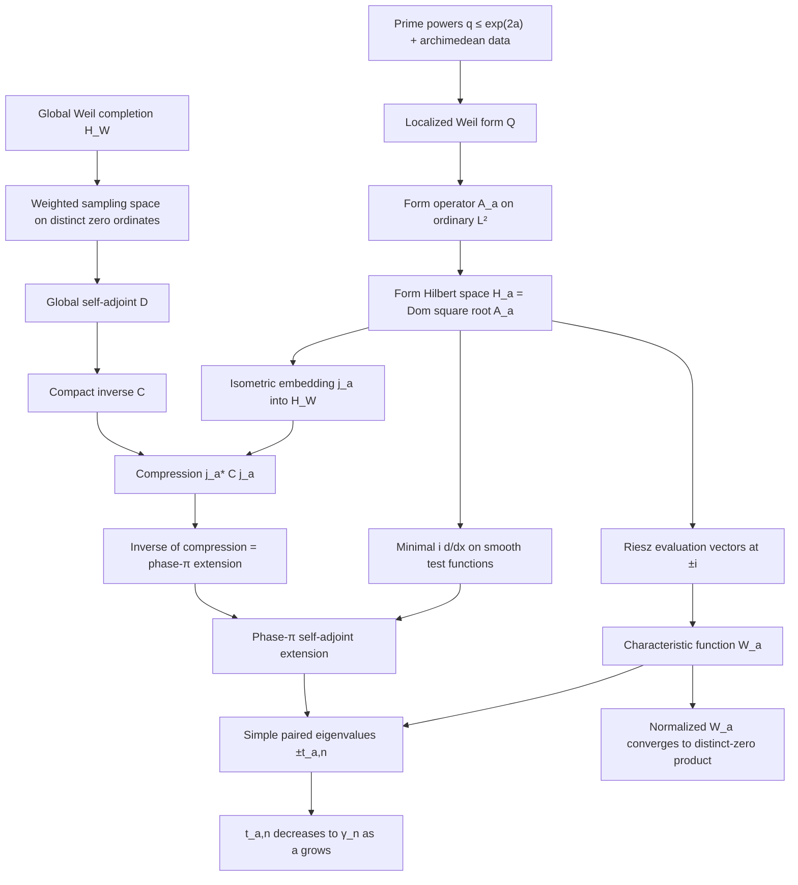

# Spectral construction — two pathways

This schematic describes Suzuki 2610.32704v1 under RH. It is an explanatory research artifact, not the Situs ontology.

Left path: arithmetic construction requires no supplied zeros. Right path: the proof uses a global spectral representation involving zeros. The form operator A_a and local differentiation extension are different operators. The global limit records distinct ordinates, not zeta-zero multiplicities. See research/reconstruction.md.
